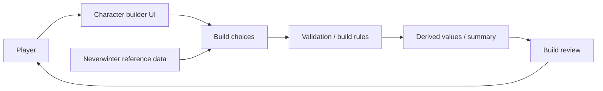
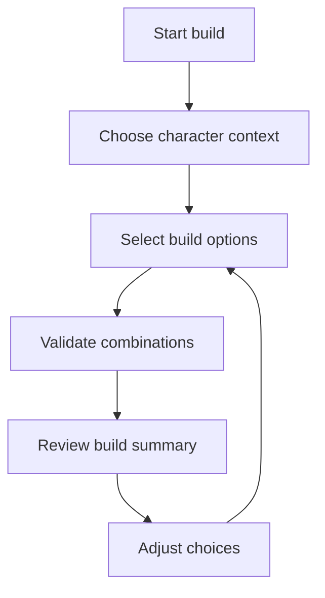
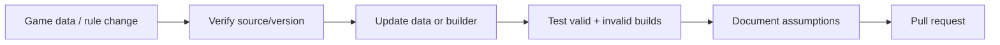

<div align="center">

# Neverwinter Character Builder Web

**A web-based Neverwinter character-building project for exploring build choices, configuration, and character-planning information in one understandable interface.**


[Browse source](https://github.com/Nischhalsubba/neverwinter-character-builder-web/tree/main) · [Issues](https://github.com/Nischhalsubba/neverwinter-character-builder-web/issues)

</div>

## Overview

This project is documented around a player-planning loop: choose character options, understand their relationships, validate the build, and review the resulting configuration. Game data should remain source-aware because Neverwinter mechanics can change between updates.

| Audience | Focus |
|---|---|
| Players | Explore and compare character choices |
| Developers | Build state, validation, calculations and data models |
| Designers | Dense configuration, comparison, states and responsive controls |
| Maintainers | Verify game data, assumptions and version-sensitive rules |

<details open>
<summary><strong>🏗️ Interactive builder architecture</strong></summary>



</details>

## Player flow



## Getting started

```bash
git clone https://github.com/Nischhalsubba/neverwinter-character-builder-web.git
cd neverwinter-character-builder-web
```

Use the manifests and lockfiles in the repository to determine the current package manager and commands.

## Product & design principles

Neverwinter build tools contain dense, version-sensitive information. Keep selections reversible, dependencies visible, invalid combinations explained, terminology consistent with verified game sources, and summaries readable without requiring players to remember where every value came from.

## SEO & discoverability

Use natural terms such as **Neverwinter character builder, Neverwinter build planner, character builds, class build planning, stats, gear, powers, companions, and Neverwinter tools** only where supported by actual features and verified data.

## Contribution flow




## GitHub Pages root-level structure

This repository stores the source entry point and support assets in the repository root. Run `npm test && npm run build`; the generated `dist/` directory is ready for the GitHub Actions Pages workflow. **One-time activation is required:** in Settings → Pages, choose **GitHub Actions**. The CI automatically validates builds and skips deployment while Pages is disabled; after activation, subsequent pushes deploy `dist/`. The nested-site readme is preserved in `docs/legacy-site-readme.md`.
